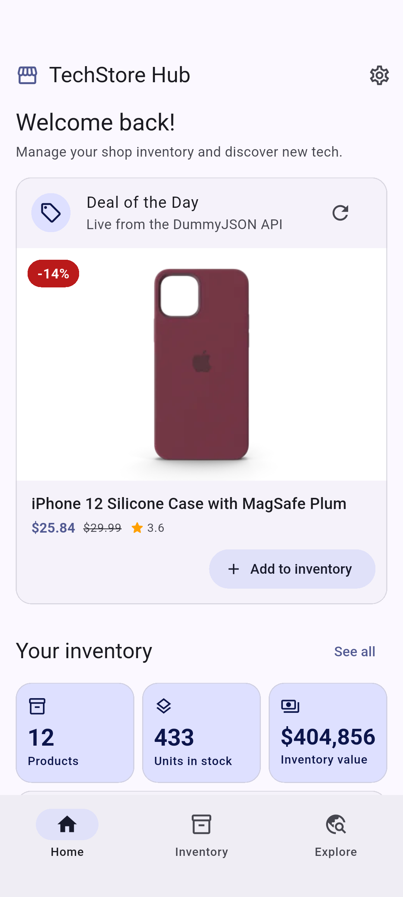
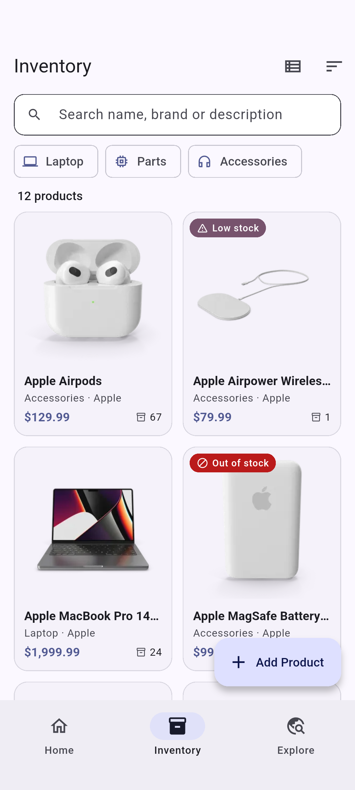
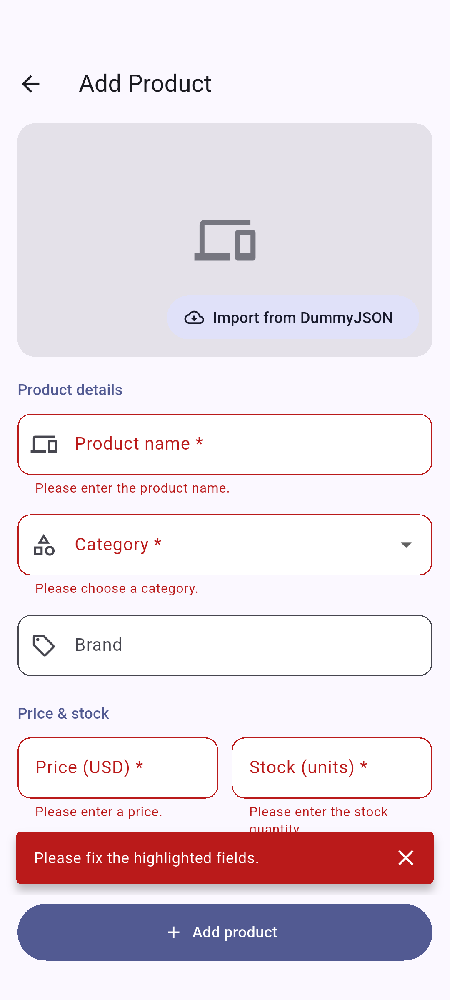
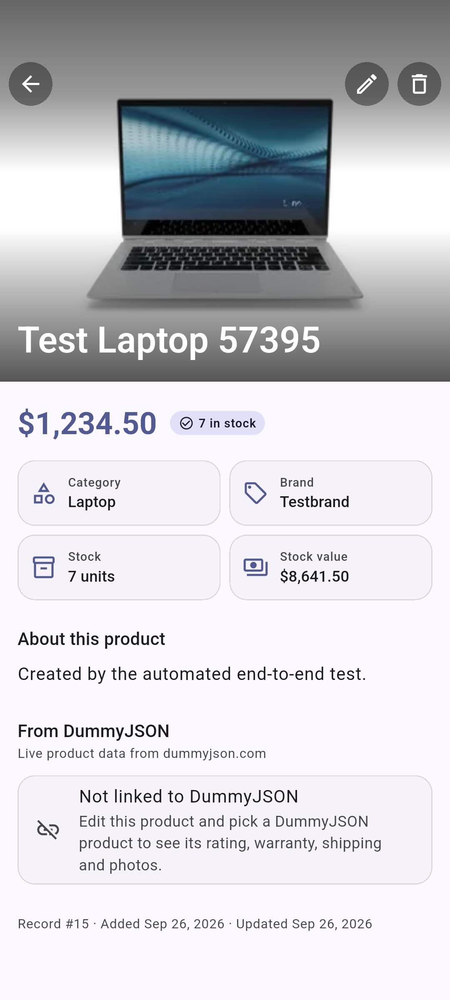
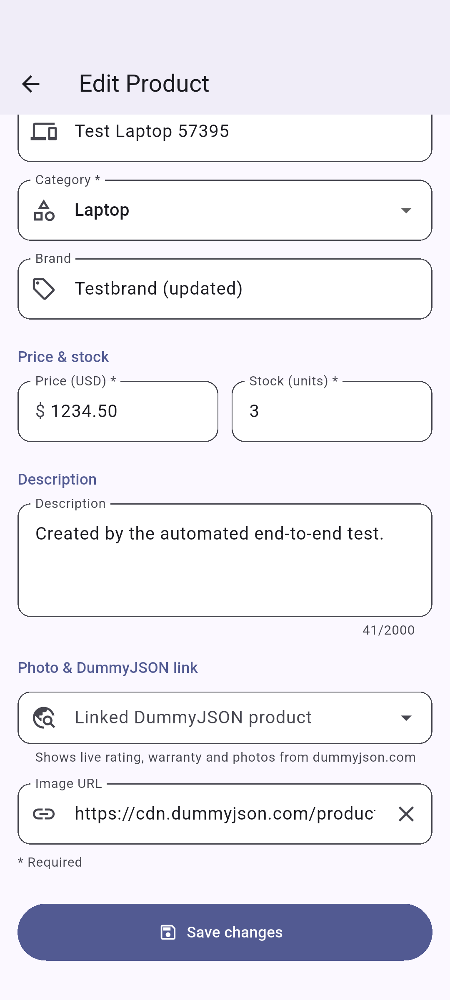
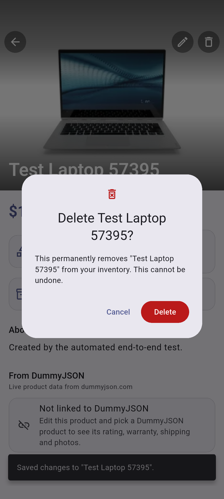
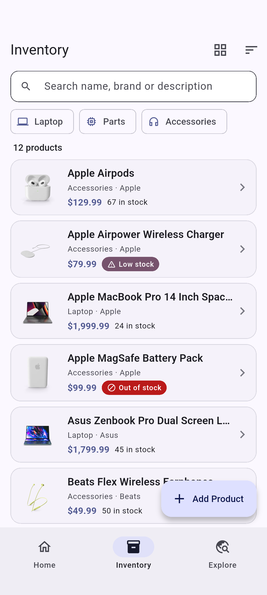
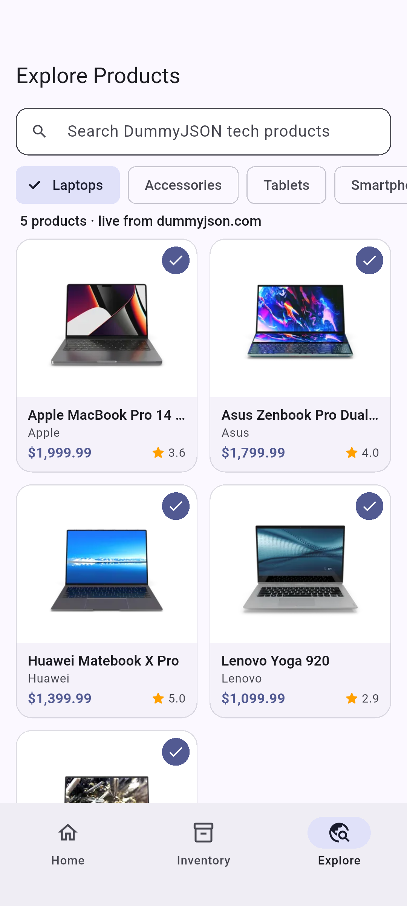
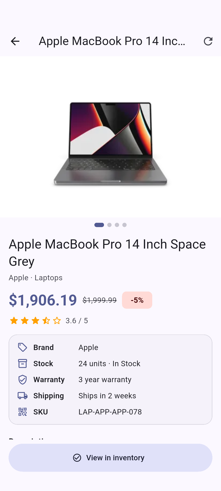

# TechStore Hub

A Flutter mobile app for managing the inventory of a small **tech shop**: laptops, computer parts and accessories, with prices in US dollars. It consumes **two APIs**:

1. **Custom REST API** – full CRUD on a `products` table, written twice with identical endpoints:
   - **Online (default):** a Supabase Edge Function (`store-api`) on Supabase Postgres – [`supabase/`](supabase/). The app works on any phone with internet, no PC needed.
   - **Local:** PHP + MySQL on XAMPP – [`backend/`](backend/).
2. **Third-party public API** – the **DummyJSON Products API** for live product data, photos, ratings and a catalog of laptops, accessories, tablets and smartphones.

## Third-party API

| | |
|---|---|
| **Name** | DummyJSON – Products API |
| **Documentation URL** | **https://dummyjson.com/docs/products** |
| **Base URL** | `https://dummyjson.com` |
| **API key** | Not required |

Endpoints used by the app:

| Endpoint | Used for |
|---|---|
| `GET /products/category/{category}?limit=0` | Explore tab (`laptops`, `mobile-accessories`, `tablets`, `smartphones`), the "Deal of the Day" card on the Home tab (laptops and mobile accessories), and the DummyJSON product picker in the form |
| `GET /products/search?q={query}&limit=0` | Live search on the Explore tab (results are filtered to the tech categories above) |
| `GET /products/{id}` | Explore product screen, the "From DummyJSON" card on a linked product's detail screen (rating, warranty, shipping, photos), and the **Import from DummyJSON** button in the form |

When a DummyJSON product is added to the shop, `laptops` becomes **Laptop**, and `mobile-accessories`, `tablets` and `smartphones` become **Accessories**.

## Features and how they meet the requirements

| Requirement | Where in the app |
|---|---|
| **Read (GET)** – list/grid + detail | **Inventory** tab: responsive grid (columns adapt to screen width) or list view, with search (name, brand, description), category filter chips, sort (name, newest, price low–high, price high–low), stock badges and pull-to-refresh. Tapping a product opens a **detail screen**, which re-fetches it with `GET products.php?id=`. |
| **Create (POST)** – validated form | **Add Product** button → form with client-side validation (required fields, name 2–120 characters and unique, price 0.01–1,000,000 with at most 2 decimals, stock a whole number 0–100,000, maximum lengths, valid http(s) image URL). Server-side `422` errors are shown under the matching field. The new product appears in the list immediately. |
| **Update (PUT)** – pre-populated form | **Edit** (pencil) on the detail screen opens the same form filled with the current values and sends `PUT products.php?id=`. "Use as cover photo" on a DummyJSON photo is also an update. |
| **Delete (DELETE)** – confirmation | **Delete** (trash) on the detail screen shows a confirmation dialog before sending `DELETE products.php?id=`. |
| **External API connection** | `lib/services/dummyjson_service.dart` calls DummyJSON with `http` GET requests, parses the JSON and caches each category. |
| **External API UI** | Home "Deal of the Day" card (discount, rating, **Add to inventory**), **Explore** tab with category chips and live search, a product screen with a photo gallery and specs, a "From DummyJSON" card on each linked product, and a DummyJSON picker in the form. |

Extras: a Home dashboard with inventory statistics (products, units in stock, inventory value, products by category, stock alerts for low and out-of-stock items, recently added), an unsaved-changes warning on the form, a **Server Settings** screen (change the API URL at runtime, with a *Test connection* button), a side navigation rail on tablets, dark mode, and friendly error and empty states.

Stock levels: **0** = out of stock, **1–5** = low stock.

## Tech stack

- **Mobile:** Flutter 3.35 / Dart 3.9, Material 3, `http`, `shared_preferences`
- **Backend (online):** Supabase Edge Function (TypeScript/Deno) + Supabase Postgres
- **Backend (local):** PHP 8.2 (plain PHP with PDO prepared statements), MySQL / MariaDB via XAMPP

## Project structure

```
supabase/
  functions/store-api/index.ts  REST API as a Supabase Edge Function (same endpoints as the PHP API)
  schema.sql                    Creates the products table (Postgres) and 12 sample products
  config.toml                   Function settings (no JWT needed to call the API)
backend/
  api/products.php        REST endpoint: GET / POST / PUT / DELETE
  api/index.php           Health check used by Server Settings
  api/helpers.php         JSON responses, CORS, validation
  config/database.php     PDO connection (defaults: root / no password)
  database/schema.sql     Creates techstore_db, the products table and 12 sample products
lib/
  config/api_config.dart  Base URLs of both APIs
  models/                 product (custom API), dummy_product (DummyJSON)
  services/               product_api_service (custom API), dummyjson_service (DummyJSON),
                          product_store (shared state), api_exception, app_services
  screens/                home_shell, dashboard, product_list, product_detail, product_form,
                          explore, explore_product, settings
  widgets/                product cards, image loader, deal card, DummyJSON picker,
                          photo viewer, error/empty views
  utils/format.dart       Price ($1,999.99), number, date and plural helpers
test/                     unit + widget tests (fake HTTP clients)
integration_test/         end-to-end CRUD test against the live API
test_driver/              saves the integration test's screenshots to docs/screenshots/
```

## Setup

### Option A – Online with Supabase (default)

1. **Database:** Supabase Dashboard → **SQL Editor** → New query → paste [`supabase/schema.sql`](supabase/schema.sql) → **Run**.
   It only creates its own objects (the `products` table, its indexes, and the `products_set_updated_at()` trigger function), so it is safe in a project that already hosts another app. Re-running it resets the table to the 12 sample products.
2. **API:** deploy the Edge Function (no Docker needed):
   ```powershell
   npx supabase login
   npx supabase functions deploy store-api --project-ref <your-project-ref> --no-verify-jwt --use-api
   ```
   Check it in a browser: `https://<your-project-ref>.supabase.co/functions/v1/store-api/products.php` should return JSON.
3. **App:** set `hostedBaseUrl` in [`lib/config/api_config.dart`](lib/config/api_config.dart) to `https://<your-project-ref>.supabase.co/functions/v1/store-api`.

The Edge Function reads the database with the service role that Supabase provides to it automatically. The app needs **no API keys**, and Row Level Security blocks direct table access with the public key, so all reads and writes go through the custom API.

### Option B – Local with XAMPP (PHP + MySQL)

1. Start **Apache** and **MySQL** in the XAMPP Control Panel.
2. Import [`backend/database/schema.sql`](backend/database/schema.sql): open http://localhost/phpmyadmin → **Import** → choose the file → **Go**. This creates the `techstore_db` database.
   (Command line, from the project folder in **cmd.exe**: `C:\xampp\mysql\bin\mysql.exe -u root < backend\database\schema.sql`. In PowerShell, wrap it: `cmd /c "C:\xampp\mysql\bin\mysql.exe -u root < backend\database\schema.sql"`.)
3. Copy the `backend` folder to `C:\xampp\htdocs\` and rename it `techstore_api`
   (from the project folder, in cmd or PowerShell: `xcopy /E /I backend C:\xampp\htdocs\techstore_api`).
   Check http://localhost/techstore_api/api/products.php returns JSON.
4. In the app: **Home → Server settings (gear icon) → "XAMPP (this device)" → Test connection → Save.**
   On a physical phone use `http://<your-PC-IP>/techstore_api/api` (same Wi-Fi; allow Apache through Windows Firewall).

If your MySQL user has a password, edit [`backend/config/database.php`](backend/config/database.php).

### Run / build the app

```bash
flutter pub get
flutter run                      # emulator or USB-connected phone
flutter build apk --release      # APK for your phone: build/app/outputs/flutter-apk/app-release.apk
```

Copy `app-release.apk` to the phone and open it to install (allow "Install unknown apps" when asked).

## Custom REST API reference

Base URL: `https://<project-ref>.supabase.co/functions/v1/store-api` (Supabase) or `http://localhost/techstore_api/api` (XAMPP). Both behave the same.

| Method | URL | Body | Success |
|---|---|---|---|
| GET | `/products.php` | – | `200` list. Optional query: `search` (name, brand, description), `category`, `sort=name\|newest\|oldest\|price_asc\|price_desc` |
| GET | `/products.php?id=5` | – | `200` one product, `404` if missing |
| POST | `/products.php` | JSON product | `201` created product (with a `Location` header) |
| PUT | `/products.php?id=5` | JSON product | `200` updated product |
| DELETE | `/products.php?id=5` | – | `200` deleted product |
| GET | `/` (index.php) | – | `200` health check with `product_count` |

For clients that cannot send PUT or DELETE, `POST` with header `X-HTTP-Method-Override: PUT|DELETE` (or a `_method` body field) also works. Bodies may be JSON or `x-www-form-urlencoded`.

**Product JSON**

```json
{
  "name": "Apple MacBook Pro 14 Inch Space Grey",
  "category": "Laptop",
  "brand": "Apple",
  "price": 1999.99,
  "stock": 24,
  "description": "Apple M1 Pro chip, 14-inch Liquid Retina XDR display and all-day battery life.",
  "image_url": "https://cdn.dummyjson.com/product-images/laptops/apple-macbook-pro-14-inch-space-grey/thumbnail.webp",
  "dummyjson_id": 78
}
```

Responses also include `id`, `created_at` and `updated_at`.

**Validation rules** (checked both in the app and on the server)

| Field | Rule |
|---|---|
| `name` | required, 2–120 characters, unique (ignoring letter case) |
| `category` | required: Laptop, Parts, Accessories |
| `brand` | optional, max 60 characters |
| `price` | required number from 0.01 to 1,000,000, at most 2 decimals (USD) |
| `stock` | required whole number from 0 to 100,000 |
| `description` | optional, max 2000 characters |
| `image_url` | optional, valid http(s) URL without spaces or accents, max 500 characters |
| `dummyjson_id` | optional positive whole number: the id of the linked DummyJSON product, e.g. `78` |

**Response format**

```json
{ "success": true,  "count": 12, "data": [ … ] }
{ "success": true,  "message": "Product created.", "data": { … } }
{ "success": false, "message": "Please fix the highlighted fields.",
  "errors": { "name": "A product with this name already exists." } }
```

Status codes: `200` OK, `201` created, `400` bad request (invalid JSON or id), `404` not found, `405` method not allowed, `415` multipart body with PUT/DELETE (PHP only), `422` validation failed, `500` database error.

## Tests

```bash
flutter analyze
flutter test                      # unit + widget tests, no server needed
```

End-to-end test on an emulator against the real API. It creates, reads, updates and deletes a product and visits the DummyJSON screens. Against the online API:

```bash
flutter test integration_test/app_test.dart
```

To also save screenshots to `docs/screenshots/` (single line, works in cmd and PowerShell):

```bash
flutter drive --driver=test_driver/integration_test.dart --target=integration_test/app_test.dart --dart-define=SCREENSHOTS=true
```

For the local PHP API instead, start `C:\xampp\php\php.exe -S 0.0.0.0:8000 -t backend` and add `--dart-define=API_BASE_URL=http://10.0.2.2:8000/api`.

## Screenshots

| Home (DummyJSON deal + stats) | Inventory (grid) | Create – validation |
|---|---|---|
|  |  |  |

| Detail | Edit (pre-populated) | Delete confirmation |
|---|---|---|
|  |  |  |

| List view | Explore (DummyJSON) | DummyJSON product |
|---|---|---|
|  |  |  |

## Demo video checklist (2–3 minutes)

1. **Intro (15 s):** open `https://<project-ref>.supabase.co/functions/v1/store-api/products.php` in a browser to show the custom API returning JSON, and the `products` table in Supabase (Table Editor).
2. **Read (25 s):** open the app. The Home tab shows the Deal of the Day, inventory stats and stock alerts. Open **Inventory**, switch between grid and list, search, filter by category, sort by price, and tap a product to open its detail screen.
3. **Create (35 s):** tap **Add Product**, then **Add product** with the form empty to show the validation messages. Fill in the form, use **Import from DummyJSON** to link a product and its photo, and save. The new product appears in the list. Refresh the Supabase Table Editor to show the new row.
4. **Update (25 s):** open the new product, tap **Edit** (pencil) to show the pre-filled form, change the price or stock and save. The detail screen updates.
5. **Delete (20 s):** tap **Delete** (trash), show the confirmation dialog, confirm. The product disappears from the list and from the Supabase table.
6. **External API (30 s):** on Home, tap refresh on **Deal of the Day**. Open **Explore**, switch categories, search "apple", open a product to show its photos, rating and warranty, then **Add to inventory**.
